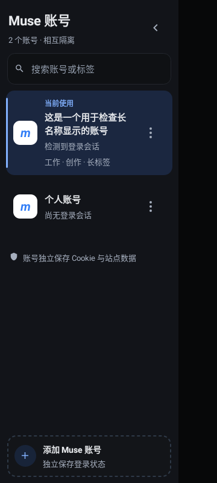
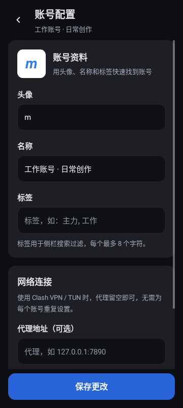
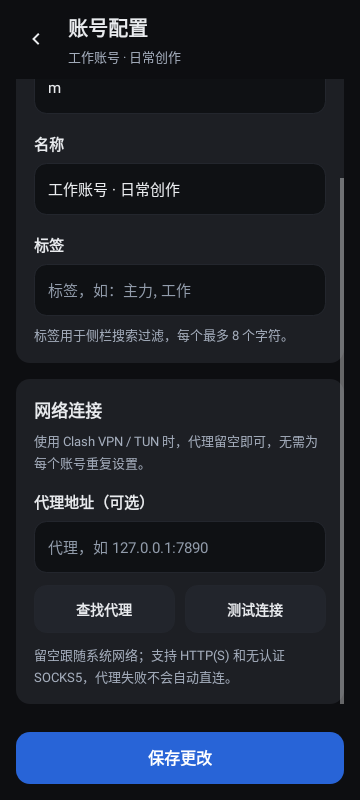

# v1.2.2 界面优化

保留深色风格、左侧账号栏和全屏浏览方式，对原生 App 外壳进行排版和交互优化。

- 账号行显示当前使用标记、会话文字和标签，给名称更多空间。三个拥挤的小按钮合并为 48dp 的管理菜单；重命名使用独立输入对话框，删除使用确认对话框。
- 搜索增加清空按钮和匹配数量，无结果说明放在列表内；关闭抽屉收起键盘。抽屉宽度随窗口调整，上限为 360dp。
- 配置页整理为资料与网络两组，使用统一的输入框、间距和按钮。保存按钮固定在底部，平板上的表单居中并限制宽度。
- 使用更易读的辅助文字颜色，主要点击区域至少为 48dp；输入框聚焦有边框，按钮有点击和禁用反馈。
- 代理检测/测试期间显示进度、锁定表单和按钮；结果有明确文字与颜色，并滚动到可见区域。Clash VPN/TUN 的留空用法直接显示在网络设置中。
- 空页面和错误页面支持滚动，横屏与大字体下仍能访问操作；错误页增加账号配置入口，加载页显示对应账号头像。
- 修正重复文案，删除无实际通知含义的圆点和已停用的旧按钮资源。

| 账号列表 | 账号资料 | 网络连接 |
| --- | --- | --- |
|  |  |  |

这些图来自 Robolectric 的 Android 原生布局渲染，使用示例账号，不代表真机截图。

验证命令：`gradlew testDebugUnitTest lintDebug assembleDebug assembleRelease`。本地 66 项测试全部通过；Lint 为 0 错误、49 条警告，Debug/Release 编译通过。布局检查覆盖 320×568（1.5 倍字体）、360×800、640×360（1.5 倍字体）、800×1000（1.3 倍字体），检查表单可滚动、按钮点击区域、账号菜单与长名称布局，以及横屏空页面和错误页的操作可达性。代理保存流程继续执行回归检查。

真实手机上的 WebView 页面、软键盘与厂商系统差异仍需设备验证。账户存储与网络隔离边界延续 v1.2.1。发布使用相同签名，versionCode 提升到 5，支持覆盖升级。
